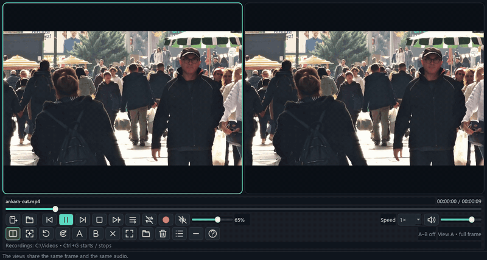
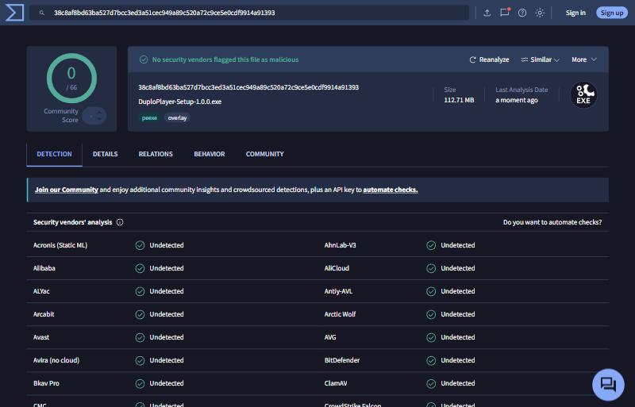

# Duplo Player

**Um vídeo, duas perspectivas.** Player de vídeo para Windows 10/11 (64 bits) que decodifica
um único arquivo e o mostra em uma ou duas telas, cada uma com seu próprio zoom e rotação,
mas com o mesmo quadro, relógio, velocidade e áudio.

*English: see [README.md](README.md). O próprio aplicativo fala português (Brasil) e inglês.*



<sub>Vídeo: [Talha Uğuz / Pexels](https://www.pexels.com/video/vibrant-street-life-in-ankara-turkey-34892306/).</sub>

## O que o torna diferente

- **O mesmo vídeo, duas vezes, em duas telas.** Ctrl+D toca um vídeo em duas perspectivas lado a lado, sempre sincronizadas.
- **Zoom em cada tela, separadamente.** Arraste um retângulo em qualquer uma para ampliar um detalhe enquanto a outra
  continua mostrando o quadro inteiro (Ctrl+S liga a seleção; Ctrl+Z desfaz só a tela selecionada).
- **Girar com um comando simples.** Ctrl+R gira a tela selecionada em 90° no sentido horário, e cada tela guarda a sua rotação.
- **Gravar o que você vê.** Ctrl+G grava a tela atual (uma ou duas perspectivas, com o zoom e a rotação escolhidos,
  e o áudio) em um arquivo MP4. Grave vários trechos (início, meio, fim…) e o Ctrl+Shift+G junta todos em um
  único vídeo.
- **Excluir vídeos dentro do player.** O botão da lixeira envia o vídeo que você está assistindo para a lixeira do Windows,
  após uma confirmação, sem precisar achá-lo na pasta. Nunca exclui definitivamente.

## Destaques

- Dupla perspectiva sincronizada: um único decodificador, dois recortes independentes.
- Repetição A–B, câmera lenta (0,1× a 0,75×) e aceleração até 2×.
- Supressão de ruído em tempo real, implementada no projeto com NumPy (FFT).
- Gravação da tela composta em MP4 (vídeo + áudio) via FFmpeg.
- Lixeira segura: usa a API moderna do Windows e recusa exclusão definitiva.
- Interface e instruções em português (Brasil) e inglês.
- Testes unitários, testes de integração com VLC real e relatório de validação (`VALIDACAO.md`).

## Stack

Python 3.11 · PySide6 (Qt 6) · LibVLC / python-vlc · NumPy · FFmpeg (via imageio-ffmpeg) ·
pywin32 · Send2Trash · PyInstaller (empacotamento) · Inno Setup (instalador) · `unittest`.

## Arquitetura

| Módulo | Responsabilidade |
|---|---|
| `main.py` | Ponto de entrada, argumentos, diagnóstico de falhas de inicialização, escolha do idioma |
| `duplo/engine.py` | Integra o LibVLC: recebe os quadros por callbacks e entrega o último quadro como `QImage` |
| `duplo/view.py` | Widget que desenha o quadro com recorte (zoom) e rotação próprios |
| `duplo/window.py` | Janela principal, atalhos, lista, laço de atualização (~60 Hz) e preferências |
| `duplo/model.py` | Lista de reprodução (ordem, repetição, histórico) e laço A–B, sem dependência de interface |
| `duplo/audio.py` | Recebe o PCM do VLC, aplica volume e filtro, envia ao dispositivo de som e à gravação |
| `duplo/noise.py` | Redução espectral de ruído em blocos, com janelas sobrepostas |
| `duplo/recording.py` | Compõe as duas perspectivas e codifica vídeo + áudio com FFmpeg |
| `duplo/explorer.py`, `duplo/recycle.py` | Integração com o Windows: abrir a pasta do arquivo e enviar à lixeira |
| `duplo/i18n.py` | Todos os textos da interface, em pares português / inglês, sem dependência do Qt |

## Instalar (para quem só quer usar)

1. Abra a página **Releases** deste repositório e baixe `DuploPlayer-Setup-<versão>.exe`
   (ou o `.zip` portátil, que dispensa instalação: extraia e execute `DuploPlayer.exe`).
2. Execute o instalador. Ele instala só para o seu usuário, sem pedir administrador.
3. Abra o **Duplo Player** pelo Menu Iniciar.

**Requisitos:** Windows 10/11 de 64 bits e um dispositivo de áudio. Não é preciso instalar
Python, VLC, FFmpeg nem o Visual C++ Redistributable: tudo vem dentro do aplicativo.

> O instalador não é assinado digitalmente. O Windows pode mostrar o aviso "O Windows protegeu
> seu computador" (SmartScreen): clique em *Mais informações* e depois em *Executar assim mesmo*.
> Se preferir não confiar num binário, use a opção abaixo e gere o aplicativo você mesmo.
> O guia [`SEGURANCA.md`](SEGURANCA.md) mostra como conferir o instalador (SHA256, VirusTotal,
> Windows Sandbox) e o resultado da análise desta versão.

### Aviso de antivírus

Executáveis gerados com PyInstaller e sem assinatura digital costumam ser marcados por alguns
antivírus como "suspeitos" (detecções genéricas/heurísticas, como `Trojan:Win32/Wacatac` ou
`Generic.ML`). Isso acontece porque o PyInstaller empacota um interpretador Python que extrai e
carrega o programa na hora de abrir, um comportamento parecido com o de alguns malwares.
Não significa que o arquivo esteja infectado.

Para conferir você mesmo:

1. Cada versão em **Releases** traz o SHA256 do instalador e o link da análise no
   [VirusTotal](https://www.virustotal.com). Compare o hash do arquivo baixado:
   ```powershell
   Get-FileHash .\DuploPlayer-Setup-<versão>.exe -Algorithm SHA256
   ```
2. Se o hash for igual, a análise do VirusTotal vale para o seu arquivo. Poucas detecções
   genéricas entre dezenas de antivírus são o falso positivo descrito acima.
3. Se ainda tiver dúvida, gere o aplicativo a partir do código-fonte (seção abaixo).

Resultado da versão 1.0.0 (`DuploPlayer-Setup-1.0.0.exe`, SHA256 `38c8af8b…1393`): nenhum antivírus apontou
o arquivo, 0/66 na [análise do VirusTotal](https://www.virustotal.com/gui/file/38c8af8bd63ba527d7bcc3ed3a51cec949a89c520a72c9ce5e0cdf9914a91393/detection)
de 21/10/2026, 20:22 UTC.



## Usar o código-fonte

**Pré-requisitos:** Windows 10/11 de 64 bits, **Python 3.11 de 64 bits** (com o *py launcher*,
que vem no instalador oficial do python.org), PowerShell e internet na primeira execução
(para baixar as dependências e o VLC portátil). Git é opcional.

```powershell
git clone <url-do-repositorio>
cd duplo-player
.\setup.ps1                          # cria .venv, instala dependências e baixa o VLC portátil (confere o SHA256)
.\.venv\Scripts\python.exe main.py   # abre o player
```

Se o PowerShell bloquear os scripts, rode uma vez `Set-ExecutionPolicy -Scope Process Bypass` na mesma janela.
Também dá para abrir com um duplo clique em `Iniciar.cmd`.

### Gerar o executável e o instalador

```powershell
.\build.ps1        # gera dist\DuploPlayer\DuploPlayer.exe (versão portátil, usa PyInstaller)
.\installer.ps1    # gera dist-installer\DuploPlayer-Setup-<versão>.exe (precisa do Inno Setup 6)
```

O Inno Setup 6 é gratuito: <https://jrsoftware.org/isdl.php>. O script do instalador está em
`installer/DuploPlayer.iss`.

### Publicar uma versão (GitHub Actions)

O workflow `.github/workflows/build-windows.yml` roda no Windows do GitHub, executa o mesmo
processo acima e anexa o instalador e o `.zip` portátil à página de Releases quando você cria uma tag:

```powershell
git tag v1.0.0
git push origin v1.0.0
```

Também pode ser disparado manualmente na aba *Actions* (nesse caso o resultado fica como artefato da execução).

## Testes

```powershell
.\.venv\Scripts\python.exe -m unittest discover -s tests -v   # testes unitários e de interface
.\.venv\Scripts\python.exe tests\integration.py              # integração com VLC real (vídeos sintéticos)
```

Os testes de integração criam vídeos sintéticos em `test-output/` (ignorado pelo git).
Veja o resultado e os limites da validação em `VALIDACAO.md` (versão em inglês: `VALIDATION.md`).

## Idioma da interface

O aplicativo fala português (Brasil) e inglês. Na abertura ele usa, nesta ordem:

1. a variável de ambiente `DUPLO_LANG` (`en` ou `pt`);
2. o idioma escolhido antes: clique direito na imagem e escolha **Idioma / Language**;
3. a configuração de idioma e região do Windows (português se for português, inglês nos demais casos).

O idioma escolhido no menu vale a partir da próxima abertura do aplicativo. O instalador também oferece os dois idiomas.
Todo o texto fica em `duplo/i18n.py`, e `tests/test_i18n.py` confere que cada texto existe nos dois idiomas.

## Como foi feito (com IA)

Desenvolvi este projeto guiando assistentes de IA de programação por meio de prompts
(vibe coding): eu descrevia o comportamento desejado, testava, apontava os defeitos
e pedia correções. Por isso o repositório dá bastante peso a testes e à validação por escrito:
eram a forma de verificar que o comportamento pedido de fato funcionava.
Os limites conhecidos estão listados abaixo e em `VALIDACAO.md`.

## Limites conhecidos

- Funciona apenas no Windows (usa pywin32, Explorer e lixeira do Windows).
- As gravações são salvas em `C:\Videos`, caminho fixo no código.
- Os testes usam vídeos sintéticos curtos; 4K/8K e todos os perfis de codec não foram certificados.

## Licença

O código-fonte do Duplo Player é distribuído sob a [Licença MIT](LICENSE), copyright (c) 2026 Marcos Amorim.
(O texto da licença está em inglês, que é a versão que vale juridicamente.)
A Licença MIT cobre apenas o código próprio deste projeto. Os componentes incluídos
(VLC, FFmpeg, Qt e outros) mantêm as suas próprias licenças.

## Licenças de terceiros

Veja `THIRD-PARTY.md` (em inglês; versão em português em `THIRD-PARTY.pt-BR.md`) e a pasta `licenses/`. O VLC e o FFmpeg não ficam no repositório:
o VLC é baixado pelo `setup.ps1` e o FFmpeg vem do pacote `imageio-ffmpeg`.
Os binários publicados em Releases incluem esses componentes; o código-fonte correspondente
do FFmpeg e do VLC está disponível nos sites dos projetos (links em `THIRD-PARTY.md`).

---

## Guia de uso

### Recursos

- Clique direito na imagem: abrir a pasta com o vídeo reproduzido selecionado no Explorer,
  por identificação nativa do Windows (inclusive espaços, vírgulas e acentos);
  enviar o vídeo à lixeira, sempre com confirmação e Cancelar como padrão.
- Todos os controles ficam abaixo do vídeo. Passe o mouse sobre os ícones para
  consultar a função e o atalho.
- O ícone de ordem alterna **Sequencial → Aleatório vídeo → Aleatório lista**.
  Aleatório vídeo sorteia outro item a cada avanço, podendo revisitar arquivos.
  Aleatório lista embaralha sem repetir itens no mesmo ciclo.
- O ícone de repetição alterna **Sem repetição → Repetir vídeo → Repetir lista**.
  A ordem e a repetição são independentes. Sem repetição, os modos aleatórios
  encerram após um ciclo de tamanho igual ao da lista; o sorteio por vídeo pode
  revisitar arquivos durante esse ciclo. Repetir lista permite novos ciclos.
  Repetir vídeo mantém o arquivo atual. Ao repetir o mesmo vídeo, os dois zooms,
  a divisão, a tela cheia e a velocidade são preservados.
- Repetição A–B: pressione **3** para marcar o início A; avance e pressione **3**
  novamente para marcar o fim B e repetir o trecho. Um novo toque em **3** inicia
  a marcação de outro trecho. **A** e **B** também podem ser usados separadamente.
  B precisa estar pelo menos 0,1 s depois de A. Limpar A–B desativa o trecho.
  A–B tem prioridade sobre os modos de repetição e é limpo ao trocar de arquivo.
- Zoom: pressione **Ctrl+S** (ou **Z**), clique e arraste um retângulo na imagem.
  Funciona no modo janela e em tela cheia, inclusive em cada tela da divisão.
  Pressione **Ctrl+S** novamente para desativar a seleção.
  A região selecionada é ampliada preservando a proporção. Você pode ampliar
  novamente sobre o recorte atual. Barras fora da imagem não entram na seleção.
- Dividir tela: **Ctrl+D** (ou **D**) ativa a tela dupla; pressione novamente para desativar, inclusive em tela cheia. Cada perspectiva aceita um recorte diferente.
  Clique em uma delas para selecioná-la e use **Ctrl+Z** (ou **R**) para restaurar somente seu zoom.
- Rotação independente: **Ctrl+R** gira a perspectiva selecionada 90° no sentido
  horário: **0° → 90° → 180° → 270° → 0°**. Clique na tela desejada antes de girar.
  Funciona em tela cheia, com zoom e na gravação; repetir o vídeo mantém a rotação.
- Tela cheia real: **F11** ou duplo clique mostram somente o vídeo, sem botões,
  títulos ou lista. A divisão e os recortes de zoom são preservados. **Esc** retorna
  ao modo janela. Atalhos e menu do botão direito continuam disponíveis. Leve o mouse
  à parte de baixo da tela para ver a barra de tempo flutuante (clique ou arraste para
  buscar); ela some quando o mouse sai dela e nunca entra na gravação.
- Câmera lenta de **0,1× a 0,75×**, velocidade normal e acelerada até **2×**.
  A tecla **-** reduz em etapas: **0,75× → 0,5× → 0,25×**, também em tela cheia.
  A tecla **+** aumenta a velocidade, passando por **1×** e acelerando até **2×**.
  **E** pausa e avança um quadro. O áudio pode ser afetado em velocidades extremas.

### Supressão de ruído

O ícone de ruído no painel inferior liga/desliga o filtro. Ajuste a barra de
**0 a 100%** ao lado do ícone: 0% mantém o áudio original; 100% aplica a redução
máxima do filtro. **Ctrl+H** alterna o filtro também em tela cheia; o menu do
botão direito oferece a mesma barra de intensidade.

O filtro adapta a redução ao chiado de fundo e preserva o estéreo. O efeito vale
para a reprodução e a gravação, com um único áudio nas duas perspectivas.
Intensidades menores preservam mais detalhes; maiores reduzem mais o ruído. Volume, velocidade,
zoom e rotação continuam funcionando. A intensidade fica salva ao fechar, mas
o supressor sempre começa **desligado** ao abrir o player.

### Gravação

Clique no círculo vermelho ou pressione **Ctrl+G** para começar e novamente
para encerrar. O MP4 é salvo automaticamente em **C:\Videos**, com data e hora.
Em tela cheia, use Ctrl+G ou a opção de gravação do menu do botão direito.

A gravação contém o vídeo exibido e seu áudio, sem controles, títulos, cursor,
lista ou outros aplicativos. As perspectivas divididas aparecem lado a lado,
com o zoom de cada uma. Mudanças de divisão, zoom, rotação, velocidade, busca e repetição
entram na gravação. Ao pausar, a imagem fica congelada e o áudio fica em silêncio.
Ao fechar o player, a gravação é finalizada antes de sair.

A resolução é definida no início, limitada a 1920×1080, com 30 quadros/s e áudio
AAC estéreo. Mudanças do tamanho da janela mantêm a proporção usando barras
pretas. Durante a gravação, arquivos temporários ficam em uma pasta própria em
C:\Videos; eles são removidos após a finalização. Em caso de falha, são preservados
para recuperação. Aguarde a mensagem **Gravação salva** antes de abrir o arquivo.

#### Vários trechos em um só vídeo

Cada início/fim com Ctrl+G grava um trecho, salvo como um MP4 próprio, como acima. Grave quantos quiser,
por exemplo um no início, um no meio e outro no fim, inclusive de vídeos diferentes. Depois pressione
**Ctrl+Shift+G** (ou o botão de juntar ao lado do botão de gravar, ou o menu do botão direito) para uni-los,
na ordem em que foram gravados, em um único `Duplo_…_joined.mp4` em C:\Videos. Se um trecho ainda estiver
sendo gravado, ele é finalizado primeiro e vira a última parte. A junção copia os fluxos sem recodificar,
então é rápida e mantém a qualidade: os trechos seguintes usam a resolução do primeiro, com barras pretas se
a janela mudou de tamanho. Depois que o vídeo unido é salvo e sua duração é conferida com a dos trechos, os
arquivos dos trechos são excluídos definitivamente (não passam pela lixeira); se a junção falhar, eles são
mantidos. São necessários pelo menos
dois trechos.

### Atalhos

| Tecla | Ação |
|---|---|
| Ctrl+O / Ctrl+Shift+O | Abrir vídeos / pasta |
| Espaço | Pausar / continuar |
| Ctrl+S / Z | Ativar/desativar seleção de zoom, inclusive em tela cheia |
| Ctrl+Z / R | Restaurar somente o zoom da tela selecionada |
| Shift+R | Restaurar os dois zooms |
| Ctrl+R | Girar a perspectiva selecionada 90° no sentido horário |
| Ctrl+G | Iniciar / encerrar gravação (um trecho) |
| Ctrl+Shift+G | Juntar os trechos gravados em um só vídeo |
| Ctrl+D / D | Ativar / desativar tela dupla, inclusive em tela cheia |
| 3 | Marcar A, depois B; com trecho ativo, iniciar nova marcação |
| A / B / C | Marcar A / marcar B / limpar A–B |
| - | Câmera lenta em etapas: 0,75× → 0,5× → 0,25×; aceita teclado numérico |
| + | Aumentar velocidade até 2×, passando por 1×; aceita teclado numérico |
| [ / ] | Diminuir / aumentar velocidade |
| E | Pausar e avançar um quadro |
| ← / → | Retroceder / avançar 5 segundos |
| 1 / 2 | Vídeo anterior / próximo vídeo |
| N / P / S | Próximo / anterior / parar |
| M | Silenciar |
| Ctrl+H | Ligar / desligar supressão de ruído |
| F11 / duplo clique na imagem | Tela cheia: somente vídeo, preservando divisão |
| Esc | Sair da tela cheia; no modo janela, cancelar seleção de zoom |
| Ctrl+L | Mostrar / ocultar lista no modo janela |
| F1 | Ajuda |

### Formatos e limites

O motor VLC aceita os principais contêineres e codecs, incluindo MP4, MKV, AVI,
MOV, WMV, WebM, FLV, MPEG, TS/M2TS, VOB, OGV e 3GP, com codecs como H.264,
H.265/HEVC, MPEG-4, VP8/VP9 e AV1. Suporte real depende do codec, perfil,
integridade do arquivo e desempenho do computador. DRM não é suportado.

Esta versão duplica **o mesmo arquivo**, não compara dois arquivos distintos.
O zoom é digital; ele não cria detalhes ausentes na imagem original.
A saída compartilhada usa decodificação por CPU para permitir os dois recortes.
Vídeos 4K/8K ou com muitos quadros por segundo podem exigir mais processamento.
A precisão de busca e de A–B depende do codec e dos quadros-chave do arquivo.

A lixeira usa a API moderna do Windows e recusa operações de exclusão definitiva.
Somente discos locais fixos são aceitos. Arquivos de rede, pendrives e situações
em que o Windows não disponibiliza reciclagem são recusados. Não há fallback
para apagar permanentemente. Se o envio falhar, o player informa o erro.
